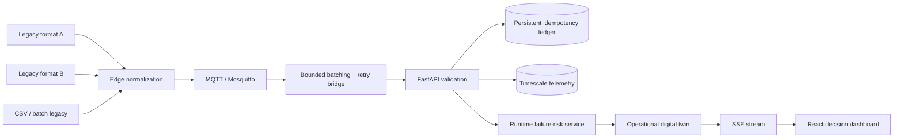

# PlantShift
## Brownfield Smart-Factory Transformation Decision Platform

PlantShift is a student-scale Industry 4.0 decision-support system for a **brownfield** factory. Its core question is:

> Given a legacy factory, limited budget, implementation capacity, operational constraints, and several digital-transformation options, what should management digitize first, why, and what does simulation show could happen?

PlantShift is not a generic sensor dashboard and not a production industrial digital twin. Factory data and failure labels are **SYNTHETIC**; scenario outcomes are **SIMULATED**; financial effects are **ESTIMATED / ILLUSTRATIVE**; only executed tests and benchmarks are called **MEASURED**.

## Decision flow


## What is implemented

### Stateful brownfield factory simulator

The original event-calendar simulator models Cutting (A), Processing (B), Assembly (C), manual/assisted Quality, and Packaging (D), with finite buffers, blocking, due dates, stateful degradation, failures/repairs, defects, rework, scrap, late orders and energy use. Vibration, temperature, RPM and power are correlated with operating condition instead of generated as unrelated random values.

Demand varies by configurable periods (HIGH / MEDIUM / LOW). Planned maintenance is a real simulator event. The `maintenance_window` intervention exposes only scheduled policies: `MAINTENANCE_NOW`, `NEXT_SHIFT`, and `LOW_DEMAND_WINDOW`; each causes real machine unavailability, queue growth/starvation and downstream KPI effects. `RUN_TO_FAILURE` is a comparison/baseline policy rather than a fake intervention. Condition-triggered maintenance is provided separately by `condition_maintenance` and uses a bounded history of observable vibration, temperature, RPM, energy and load to compute a transparent condition score. Hidden `wear` is not a maintenance-decision input. Scheduled strategies are horizon-validated: for example, `LOW_DEMAND_WINDOW` starts at 16h, so an 8h/16h run is rejected instead of silently producing zero planned downtime; the UI defaults to 24h and exposes 8h/16h/24h/48h/72h choices.

### Operations metrics and diagnosis

PlantShift calculates throughput, utilization, WIP, time-weighted queue lengths, lead time, planned/unplanned downtime, defects, scrap, rework, late orders, total energy, energy per finished unit, and OEE as:

`Availability × Performance × Quality`.

Bottleneck diagnosis uses measured simulation evidence (utilization, input queue and downtime); no LLM selects the bottleneck.

### Transformation interventions

The catalog contains:

1. IoT retrofit
2. centralized telemetry platform
3. condition-based maintenance
4. optimized scheduling
5. buffer redesign
6. additional processing capacity
7. assisted quality inspection
8. maintenance-window optimization
9. energy-efficiency intervention

IoT does **not** directly add throughput. The retrofit improves observability/diagnostic delay; the centralized platform improves detection/availability of telemetry and enables dependent interventions. Operational improvements emerge only when simulation mechanics change.

Illustrative cost and effort defaults can be overridden through API/UI. They are not vendor quotes.

### Counterfactual + Monte Carlo engine

Scenarios apply one or more interventions to the same baseline factory. Monte Carlo comparisons use paired stochastic seeds: baseline and transformed cases receive the same seed and demand profile. Maintenance-policy comparison is likewise apples-to-apples: run-to-failure and scheduled alternatives share the same IoT observability foundation, duration, stochastic seed and demand seed. The report includes mean, median, P10 and P90 for throughput, OEE, downtime, scrap, lead time, late orders, WIP and energy changes.

### Runtime predictive-maintenance inference

The training pipeline uses only observable/deployable features:

- vibration and rolling vibration statistics
- temperature and trend/rolling statistics
- load
- RPM
- power/energy telemetry
- cycle count

The simulator's hidden `wear` variable remains synthetic ground truth for label generation/evaluation only and is **not** in `FEATURES`.

Rolling features are grouped by both `run_id` and `machine_id`, so one simulation run cannot leak history into another. Train/validation/test splitting is also **whole-run safe**: simulation runs are ordered by their earliest UTC timestamp, then complete `run_id` groups are assigned approximately 60/10/30 with disjoint run sets; the classification threshold remains validation-only. The model is loaded once at application startup. Incoming telemetry flows through a bounded feature history to model inference, then to the digital twin. `GET /api/machines/{id}/health` exposes failure probability, health state, model version, feature timestamp and warning reason. The live UI consumes the twin stream via SSE.

Current executed synthetic evaluation (`ml/artifacts/evaluation.json`):

- precision: **0.1816**
- recall: **0.2250**
- F1: **0.2010**
- ROC-AUC: **0.7915**
- PR-AUC: **0.1648**
- decision threshold: **0.80**
- whole-run split: **11 train / 2 validation / 5 test runs; overlap = false**

These are not production reliability claims.

### Robust portfolio optimizer

Exhaustive enumeration is retained because nine interventions remain small and explainable. Each feasible candidate is evaluated across multiple **paired deterministic seeds** rather than one lucky run. Candidate deltas include median, P10 and P90 for throughput, OEE, downtime, scrap, energy and late orders.

Supported objectives:

- `MAXIMIZE_THROUGHPUT`
- `MAXIMIZE_OEE`
- `MINIMIZE_DOWNTIME`
- `MINIMIZE_SCRAP`
- `MINIMIZE_ENERGY`
- `MINIMIZE_LATE_ORDERS`
- `MAXIMIZE_ESTIMATED_VALUE` — median paired-seed **ESTIMATED net financial value** using configurable business assumptions
- `MAXIMIZE_BENEFIT_PER_EFFORT` — operational composite divided by implementation effort
- `BALANCED_OPERATIONAL_IMPACT` with user-configurable non-negative KPI weights (`BALANCED` remains a backward-compatible API alias)

Constraints include budget, implementation capacity, prerequisites and maximum aggregate risk. Cost and effort overrides are honored. Every objective also evaluates an explicit **NO_ACTION** baseline candidate with zero cost, effort, risk and KPI/financial deltas. If no feasible transformation improves the selected objective, PlantShift returns `decision = NO_ACTION` and still exposes the best transformation alternatives for management review. The financial objective is deliberately separate from the operational composite: it converts each paired simulation into production-value, downtime-cost, scrap/rework-cost, energy-cost and maintenance-cost deltas, subtracts the illustrative implementation cost, and ranks on the median estimated net value with P10/P90 reported.

### Business value + sensitivity

User assumptions include value per finished unit, downtime cost/hour, scrap cost/unit, rework cost/unit, energy cost/kWh, planned maintenance cost, unplanned maintenance cost and intervention implementation cost. All monetary inputs/outputs use one user-selected **illustrative monetary unit** consistently. Estimated net value is calculated over the selected simulated operating period; it is not an annualized or guaranteed ROI claim unless the user explicitly supplies a corresponding period interpretation. The output explicitly separates baseline operating observations, SIMULATED deltas, ESTIMATED operating-value effect and ESTIMATED net value after illustrative implementation cost. Payback is illustrative, not guaranteed ROI.

Sensitivity analysis varies production value, downtime cost, energy cost and implementation cost and reports how often each candidate wins plus a HIGH / MEDIUM / LOW decision-stability label.

### Brownfield edge normalization

`LegacyEdgeAdapter` supports incompatible source formats rather than acting as a passthrough. Examples include:

- an imperial-format controller (`TEMP_F`, `VIB_IN_S`, `MOTOR_RPM`)
- a metric JSON controller (`temperature_c`, `vibration_mm_s`, `rpm`)
- a CSV/batch-style export

It performs field mapping, Fahrenheit→Celsius and in/s→mm/s conversion, machine-ID normalization, timestamp defaults and physical-value validation before producing one canonical telemetry schema.

### Persistent, late-safe telemetry ingestion

Telemetry uses two persistence layers. Within one batch, the first successfully accepted instance of an `event_id` wins: later same-batch duplicates cannot replace its stored JSON/scalars or update the digital twin.

- `processed_event_ids`: globally unique `event_id` ledger for restart-safe idempotency
- `telemetry_events`: time-series telemetry table that can be a Timescale hypertable

This design preserves both global duplicate rejection and Timescale's time-partitioning constraint. A duplicate remains idempotent after API restart. Valid out-of-order telemetry is persisted historically but never regresses the latest digital-twin state. Late events are also excluded from the runtime ML rolling feature history, so an older event cannot corrupt the next live failure-risk prediction or overwrite the current health result.

MQTT bridge delivery uses a bounded input queue plus a real bounded flush-window batch collector. The default integration settings are `MQTT_BRIDGE_BATCH_SIZE=50` and `MQTT_BRIDGE_BATCH_FLUSH_MS=50`: after the first event arrives, the worker waits only until the batch reaches its cap or the flush deadline expires. HTTP delivery keeps bounded exponential-backoff retries with jitter and a JSONL dead-letter path. Bridge metrics expose successful message delivery, successful HTTP batch deliveries, retries, dead letters, queue depth and dropped-on-full events through `/metrics` on port 9102.

### Live React UI

The existing React/Vite frontend was refactored instead of replaced. It contains 12 decision-support views:

1. Transformation Overview
2. Current-State Factory
3. Live Machine State
4. Production KPIs
5. Transformation Catalog
6. Scenario Builder
7. Scenario Comparison
8. Portfolio Optimizer
9. Sensitivity
10. Transformation Roadmap
11. ML Evaluation
12. Assumptions / Limitations

Scenario and optimizer controls expose intervention selection, 8h/16h/24h/48h/72h simulation duration, cost/effort overrides, scheduled-maintenance strategy/duration, scheduling, buffers, capacity, quality, energy parameters, business assumptions, paired run count, budget, effort/risk limits, optimization objective and operational-balance weights. A single password-style admin token control lives in the global sidebar and is shared only in page memory across protected workflows; it is not stored in local/session storage. The UI shows the selected maintenance window and blocks a scenario when its fixed window lies outside the horizon. When a scenario is run, the displayed current-state baseline is fetched again with the **same `duration_hours` and `seed`** as that transformed scenario; the Overview/Comparison labels show the common horizon so 8h and 24h KPIs are never presented as directly comparable. Financial optimizer results show implementation cost, median/P10/P90 estimated net value and the operational trade-offs rather than a single opaque score; a winning baseline is rendered explicitly as **No transformation recommended under the current assumptions and constraints.** Live machine state reconnects through browser `EventSource` automatically and cleans up on unmount.

## Architecture



## Security boundaries

Implemented controls include strict payload validation, admin-token protection for transformation controls, environment-only secrets, restricted CORS, ORM-based DB access, no arbitrary command execution, bounded queues/batches/retries, and no frontend-embedded admin secret. The low per-IP `RATE_LIMIT_PER_MINUTE` bucket remains enabled for ordinary/control API routes, while only `/api/telemetry` and `/api/telemetry/batch` are exempt so the internal MQTT bridge is not throttled by a UI-scale 120 requests/minute ceiling. Root and frontend-specific `.dockerignore` files keep local `.env` secrets, VCS metadata, virtual environments, caches, local databases, `node_modules` and build output out of Docker build contexts; runtime `POSTGRES_PASSWORD`/`ADMIN_TOKEN` enter containers through Compose environment configuration rather than `COPY` layers. The demo Mosquitto broker allows anonymous access **inside the local Compose network only**; TLS/broker authentication is a documented production gap.

## Setup

Requires Python 3.12+.

```bash
python -m venv .venv
# Windows PowerShell: .venv\Scripts\Activate.ps1
# macOS/Linux: source .venv/bin/activate
python -m pip install -r requirements-dev.txt
```

Set local-only environment values, then:

```bash
python scripts/train_ml.py --if-missing
python -m pytest
uvicorn backend.app.main:app --host 127.0.0.1 --port 8000
```

### Full Docker demo

Copy `.env.example` to `.env`, replace placeholder secrets, then run:

```bash
docker compose up --build
```

Intended topology: pinned Timescale/PostgreSQL → Mosquitto → bounded batching/retry MQTT bridge → FastAPI/ML/twin → React UI. The backend container runs `python scripts/train_ml.py --if-missing` before Alembic migration and FastAPI startup, so a clean Git clone generates the synthetic runtime model only when required artifacts are absent. The root `.dockerignore` ensures a locally created `.env` is not copied into backend/simulator/bridge image layers; the frontend has its own context-specific `.dockerignore`. Docker execution is not claimed unless it actually runs in the target environment.

## Dependency reproducibility status

Python and frontend direct dependencies remain explicitly pinned. A genuine resolver-generated `uv.lock` and `package-lock.json` could not be created in this sandbox because external package resolution is unavailable and the required registries are not cached. The repository does **not** fabricate either lock. See `docs/dependency-lock-status.md` and `frontend/DEPENDENCY_LOCK_STATUS.md` for the exact failed commands and reproduction steps.

The frontend ESLint 9 flat configuration is TypeScript-aware and pins `typescript-eslint` to `8.24.0`, alongside the existing exact ESLint/TypeScript versions. In this sandbox the npm registry is unreachable, so that configuration is source-validated but the dependency-based `npm run lint`, `npm test`, and `npm run build` gates are not claimed as passed.

## Benchmarks

Run the local in-process benchmark:

```bash
python -m benchmarks.run_benchmarks
```

The file `benchmarks/results/benchmark_results.json` is explicitly an **IN-PROCESS TELEMETRY MICROBENCHMARK**. It does not claim MQTT/API/PostgreSQL throughput.

Run the real Docker E2E benchmark after Compose is healthy:

```bash
python -m benchmarks.run_e2e_ingestion --admin-token "$ADMIN_TOKEN"
```

That benchmark measures simulator → MQTT → bounded batching/retry bridge → HTTP API → validation → PostgreSQL/Timescale → twin. It records messages published/persisted, failures, wall throughput, persisted p50/p95/p99 latency, retry count, dead-letter count, queue drops, and successful HTTP batch deliveries. If Docker services are unavailable, `benchmarks/results/e2e_ingestion_results.json` remains `NOT EXECUTED` rather than containing invented values.

## Verification status

See `docs/verification-report.md` for exact commands, test counts, executed metrics and environment limitations. The README intentionally does not turn unexecuted Docker/frontend/Ruff/mypy checks into claims. Sensitivity analysis also requires every candidate to use the same `seed` and `duration_hours`; mixed comparisons return HTTP 422 instead of sharing an invalid baseline.
