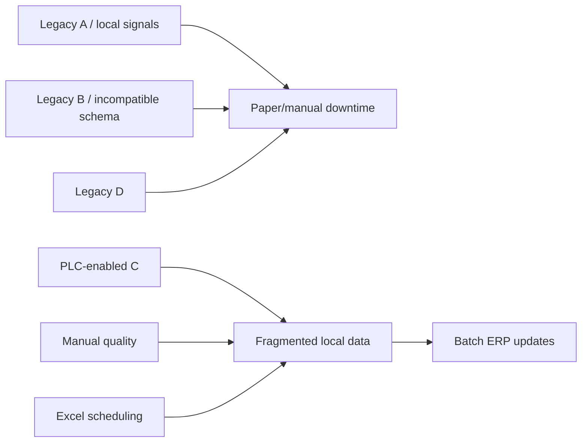

# Brownfield current-state architecture

The starting plant deliberately lacks unified telemetry, shared machine-health inference and coordinated transformation planning. PlantShift's edge adapters model the normalization work required before legacy machines can participate in a canonical MQTT/event pipeline.
